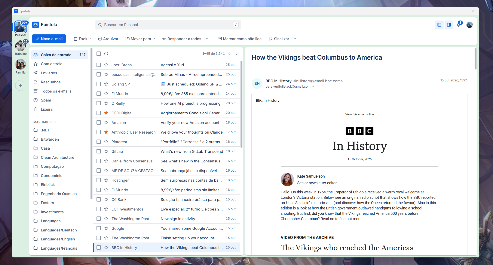

# Epistula

**English** | [Português](README.pt-BR.md)

A desktop email client that keeps your messages on your own computer, encrypted, and never routes them through a server of ours.

Epistula connects your accounts, downloads what you need to read and stores it in a local database protected by AES-256. The key lives in your operating system's credential vault. There is no Epistula account and no Epistula cloud. The only server of ours on the way will be a sign-in server, for the OAuth login with Google and Microsoft; your mail goes straight between your computer and your provider. And opening an email archive (a Gmail, Outlook, Thunderbird or Apple Mail backup) will need no account and no connection to us at all.



> Epistula is under active development. Reading, sending, organizing, rules, conversations, notifications, offline reading, multiple accounts, end-to-end encryption (OpenPGP and S/MIME) and opening email archives from other programs, with no account, work today. Next up: the sign-in server and encrypted backups. [Current state](#current-state) lists exactly what exists right now.

## At a glance

- **No Epistula account, no Epistula cloud.** Your mail goes straight to your provider. Our sign-in server (planned) only takes part in the OAuth login and never sees a message.
- **Open old archives, offline and with no account.** Gmail Takeout, Outlook, Thunderbird and Apple Mail backups, read from the file, without connecting to anything.
- **Everything on disk is encrypted.** Messages, subjects, senders and indexes live in an AES-256 database, which already holds up against quantum computers.
- **Opens instantly, even offline.** Recent mail is downloaded in the background and opens from disk.
- **Blocks tracking.** Remote images (the "spy pixels" that tell senders you opened their email) stay blocked until you allow them.
- **Conversations that read well.** Each reply in its own card, with quoted text tucked away.
- **Organizes itself.** Rules move, archive or flag mail as it arrives, with a live preview before you save and undo afterwards.
- **Tells you only what matters.** Windows notifications, a tray icon, quiet hours and a history behind the bell.
- **Security you can check.** A public threat model, and tests that fail if any content shows up in the logs.

## Why another email client

Email is the longest-running archive in most people's digital lives. Contracts, medical results, family threads, the password reset for everything else. And that archive usually lives in a single place, run by someone else, reachable through a browser tab.

Epistula starts from three simple ideas:

**Your data stays with you.** Every message you open is stored on your disk. If the network drops, your mailbox is still there. If your provider changes its rules, your copy is still yours.

**What sits on disk is encrypted.** The whole database is encrypted, including indexes, subjects and senders. A copied file, a laptop left in a cab or a discarded drive reveals nothing without the key.

**Security is shown, not promised.** The threat model is public, the risks we have not solved yet are written down, and the guarantees that can be tested have tests.

## Current state

What works today:

**Accounts and security**

- Google accounts over OAuth (PKCE), reading through IMAP and sending through SMTP, always over TLS. Your password never passes through the app.
- Several accounts at once, each with its own name, color and photo, one click apart.
- Local SQLCipher database (AES-256, per-page HMAC), with the key in the Windows Credential Manager and secure deletion of freed pages.
- Safe reading: third-party HTML is cleaned against an allowlist in the Rust process and shown in an iframe with scripts disabled. Remote images stay blocked until you allow them, one message at a time.
- Private notifications: you choose whether they show sender and subject or just the account.

**Reading**

- Conversations as cards: each reply on its own, unread ones open, quoted text hidden behind a "…".
- Offline reading: after every sync, mail from the period you pick (30 days, 90 days, everything, or only when opened) is downloaded in the background, without marking it as read.
- Instant opening: the app fetches the next messages in the list, the rest of the conversation and the one under your mouse ahead of time.
- Staged first sync: the list shows up with the 200 most recent messages, and the rest arrives gradually.

**Writing and organizing**

- Compose, reply, reply all and forward, with drafts saved encrypted.
- Folders and labels, flags with due dates, and move, archive, delete and mark as read for one message or many, including drag and drop onto a folder.
- A command bar, and background sync with a per-account interval.

**Search**

- Search every folder at once, offline, in one account or across all of them (email archives included, each result with its account's avatar).
- People, dates and filters turn into chips in the search field: type operators such as `de:` (or `from:`), `para:` (or `to:`), `cc:`, `depois:`, `antes:`, `em:2025`, `tem:anexo` and `na:` for a folder, or pick them from the suggestions, which list the people you already exchanged mail with.
- Recent searches stay on this computer; saved searches show up in the folder column with their unread count.
- Act on the results like any list, or apply one of your rules to them, with a preview first and Undo afterwards. A search can also become a new rule.

**Rules**

- Rules that organize mail as it arrives, before it turns into a notification. Each rule reads as a sentence: "If From contains @shop.com → Move to Shopping".
- Conditions on sender, domain, To and Cc, "sent only to me", subject, text snippet, mailing list, attachments, size, read and starred, with "all" or "any" and exceptions ("except if…"). Case and accents don't matter, and several comma-separated values count as "any of them".
- Actions: move, archive, delete (always to the Trash), apply a label, mark as read, star, flag with a due date, don't notify and always notify (even in Do Not Disturb). Rules run in order, and one can stop the rest.
- Live preview in the editor: before saving you see how many and which messages the rule would catch, plus a warning when a rule above keeps it from running.
- Everything can be undone: the history keeps 30 days of what each rule did, with Undo on each batch, and a notice after each sync shows what got organized.
- Start from a template (Newsletters, Automatic notices, Receipts and invoices, Important people) or straight from a message: "Create rule…", "Always move from this sender to…" and "Delete everything from this sender…".
- "Run now" applies a rule to the mail already in a folder, and cleanup rules ("older than 30 days", "keep only the newest from this sender") run once a day.
- Rules run inside Epistula while it's open (including in the tray) and work with any provider. Mail that arrived while the app was closed goes through them on the next sync.

**End-to-end encryption**

- OpenPGP built in: create a key (Curve25519, RSA 4096, or an experimental post-quantum one with ML-KEM-768 + X25519), import one you already have, or restore an Epistula backup.
- A lock in the composer encrypts and signs the message. It turns itself on when every recipient has an accepted key, and replies to encrypted mail start encrypted. The subject can be hidden from the server too.
- Recipients without a key are flagged before sending, with the choice to look their key up online (only when you say so), send without encryption, or remove them.
- Reading shows whether a message was encrypted and whether the signature checks out, with the key's acceptance in Thunderbird's style (not yet, accepted, verified, rejected).
- A key manager with search, import from a file, the clipboard or the internet, export and a password-protected backup. Keys arriving by Autocrypt or as an attachment are stored as "not yet accepted", including a key attached inside an encrypted message. The first message from someone new is checked against the key they attached, and the Autocrypt header Epistula sends can be read by other programs.
- S/MIME too, for people on Outlook, Apple Mail or a company certificate: request a certificate (the key pair is created on your computer and only the request goes to the certificate authority), import the issued one or a `.p12`, and keep the certificates of whoever sends you signed mail. Trust follows the root certificates in Windows. A test CA script lets you try it without buying anything.

**Email archives, with no account**

- Open a backup or a mail folder from another program, straight from the first screen or by dropping it on the window: the Google Takeout `.mbox` (labels kept as labels), Outlook `.pst` and `.msg`, Thunderbird profile folders, Apple Mail `.mbox` exports and `.emlx`, `.eml` files and Maildir.
- No account, no server and no network at all: the file is read on your computer and copied into the encrypted database. The original is only read, never changed.
- Before importing you see the format, the folders (pick which ones go in), and how much disk space it will take; afterwards, how many came in, how many were duplicates and how many failed, and why. Importing the same backup twice duplicates nothing, and an import interrupted by closing the app can be resumed.
- The archive shows up next to your accounts, with its original folders. Reading, conversations, search, moving, flagging and deleting work as in an account, all on this computer; encrypted messages open with your OpenPGP keys and S/MIME certificates. Removing it erases its messages and rotates the database key.

**Staying informed**

- Windows notifications for new mail, replies to your emails, due dates and accounts that need attention. One click opens the message.
- The app stays in the system tray with the window closed, with "new email" and snooze.
- Quiet hours and a bell with the last 7 days of notices.

**Appearance**

- Light, dark or system theme, a customizable background color, list density, and collapsible columns to focus on reading.

What does not exist yet:

- Providers other than Google. The data model already covers Outlook, Yahoo, iCloud, Zoho, GMX, AOL and generic IMAP.
- The sign-in server (see below), and `.olm` files from Outlook for Mac.
- Code signing for the installer (see [Installing](#installing)).

## Installing

Download `Epistula_<version>_x64-setup.exe` from the [Releases](https://github.com/elyosemite/epistulamail/releases) page. It installs for your Windows user only, with no administrator rights, and needs Windows 10 or 11 (64-bit) with WebView2, which ships with Windows 11 and is downloaded by the installer on Windows 10 if missing.

The installer is not code-signed yet, so on first run Windows SmartScreen says "Windows protected your PC". Before going ahead, check the file against the SHA-256 published with the release:

```powershell
(Get-FileHash .\Epistula_1.0.0_x64-setup.exe).Hash
```

If it matches, click "More info" and then "Run anyway". Newer versions install over the old one and keep your accounts and messages. [CHANGELOG.md](CHANGELOG.md) lists what each version brings.

## Where this is going

### A sign-in server, and nothing more

Signing in with OAuth means you never type your email password into Epistula, and you can revoke access at any time on your provider's page. For that, Epistula needs registered apps with Google (Google Cloud) and Microsoft (Azure). Their settings will live on a small Epistula server instead of inside the installer, so they can be rotated without a new release.

What that server is for, and what it is not:

- It takes part in the login only. IMAP and SMTP keep going straight from your computer to your provider, and no message, subject or address book passes through it.
- It has no Epistula account and stores nothing about your mail.
- Without it you can still read everything already on your computer and open archives; only connecting a new account, and renewing access in some cases, depends on it.

Exactly what passes through it during the login (only the app's settings, or also the exchange that produces your tokens) is still an open decision, written down in the [threat model](docs/arquitetura-e-ameacas.md#planejado-servidor-de-login).

### Your data, only yours, even on your own computer

Today the database is encrypted against anyone outside your Windows session. The next step is to protect it from people inside it too: someone else using your session, the administrator of a corporate domain, or anyone holding a copy of the disk and your Windows password.

- **Epistula password (optional):** the database key gets wrapped by a key derived from your password with Argon2id. The password itself is never stored.
- **Automatic lock:** after a period of inactivity, or when Windows locks the screen, the app closes the database and wipes the key from memory.
- **Nothing leaks outside the database:** content-free notifications by default, no email in the embedded browser's cache, no crash dumps written to disk, and a heads-up when the disk has no BitLocker.
- **Keep less:** erase from your computer the mail outside your chosen period and the mail of accounts you signed out of, rotating the database key afterwards.
- **Honest links:** a warning when a link goes somewhere other than what it shows, and tracking parameters stripped.

### Ready for quantum computers

Data encrypted today can be captured today and decrypted years from now, once quantum computers can break the key exchanges in use. For email, which people keep for decades, that risk is not theoretical.

The encryption Epistula already uses on disk (AES-256) holds up in that scenario; there is no need to replace it. On the way to your provider, the app will offer the hybrid key exchange (X25519 with ML-KEM-768), which kicks in as soon as the server accepts it. And anything built on public keys (backups opened on another machine, sync between your own devices, end-to-end encrypted messages) will start out with hybrid schemes, so protection never rests on a single bet.

### Backups you control

Export a whole account to an encrypted file, keep it wherever you like (an external drive, a USB stick, the storage service of your choice) and restore it on another machine without downloading everything from the provider again. Only the key holder should be able to read it, and the format will be documented, so you are never locked into Epistula.

### Real email management

Full-text local search over the whole message body, offline included. Rules that also run on the server, with the app closed. Snoozing messages. A unified view across accounts. Signatures, templates and scheduled send. Other providers (Outlook over Microsoft OAuth, Yahoo, iCloud and generic IMAP). Sender authenticity indicators (SPF, DKIM, DMARC) shown while reading, to help spot phishing.

## How your information is handled

```
Your computer
├── Interface (WebView)      display only; never sees tokens or the database key
├── Rust process             OAuth, IMAP, SMTP, HTML cleaning, decides what reaches the screen
├── OS credential vault      refresh tokens and the database key
└── epistula.db              messages, folders and settings, fully encrypted

        │ TLS                              │ TLS, only to sign in (planned)
        ▼                                  ▼
Your email provider              Epistula sign-in server
(IMAP, SMTP, OAuth)              OAuth app settings for Google and Microsoft

Email archives (.mbox, .pst, .eml…)  ──read locally──▶  epistula.db, with no network (works today)
```

A few things worth saying plainly:

- **Your provider can still read your email** unless it goes encrypted with OpenPGP. Epistula protects the local copy and the path to it; whatever leaves without encryption stays readable by whoever hosts the mailbox, and even encrypted mail shows the server who wrote to whom and when.
- **Logs contain no content.** No subject, no sender, no account address. A test walks through the whole app with unique markers and fails if any of them shows up in the logs or in plain text in the database file.
- **Signing out revokes access** at the provider and deletes the secret from the credential vault. Messages already downloaded stay on disk, encrypted, until there is an option to erase them.
- **A compromised computer stays compromised.** Malware running in your session can read whatever you can read. No email client fixes that, and we would rather say so than pretend otherwise.

The full analysis, with the data inventory, the cryptography inventory, trust boundaries and the eighteen threats considered, is in [docs/arquitetura-e-ameacas.md](docs/arquitetura-e-ameacas.md) (in Portuguese).

## Design system

An email client gets opened dozens of times a day, and every small bit of friction turns into real annoyance. So the interface comes from its own design system, in [`design-system/`](design-system/), with tokens, typography, colors, accessibility notes and a page for each component. It changes constantly, and every new screen goes through it before it becomes code.

Four principles guide the decisions: density with breathing room, reading first, one gesture per action, and state always visible. Suggestions about interface and usability are as welcome as code.

## Building

The main target today is Windows. Epistula is built with [Tauri 2](https://tauri.app), Rust and React.

Requirements:

- Node.js 24 and pnpm 10
- Rust 1.88 or later
- On Windows, the portable Perl used to compile SQLCipher's bundled OpenSSL. The script below downloads it and checks its SHA-256.

```powershell
pnpm install
./scripts/setup-build-tools.ps1
```

Until the sign-in server exists, a development build reads the OAuth settings from `.env`. Create your own clients: a "Desktop app" client in Google Cloud, and an app registration in Azure (Microsoft Entra ID) with the "Mobile and desktop applications" platform and `http://127.0.0.1` as the redirect URI (the app listens on a random port of that address; if the portal refuses the IP, add it in the app's Manifest).

```powershell
Copy-Item .env.example .env
# EPISTULA_GOOGLE_CLIENT_ID=...
# EPISTULA_GOOGLE_CLIENT_SECRET=...
# EPISTULA_MS_CLIENT_ID=...
```

`.env` is ignored by git; never commit it.

Then:

```powershell
pnpm tauri dev      # development
pnpm tauri build    # installer
```

Releases are built by [`.github/workflows/release.yml`](.github/workflows/release.yml): pushing a `vX.Y.Z` tag that matches the version in `package.json`, `src-tauri/Cargo.toml` and `src-tauri/tauri.conf.json` builds the NSIS installer with the OAuth clients from the repository secrets and opens a draft release with that version's section of `CHANGELOG.md` and the installer's SHA-256. Running the workflow by hand builds the same installer as a test, without a release.

## Tests

```powershell
pnpm test                         # interface
cd src-tauri; cargo test          # backend, against a real SQLCipher database
cargo clippy --all-targets -- -D warnings
```

CI runs all of this on Windows on every push, plus a scan of the repository history for committed secrets.

## Layout

```
src/                 React interface
src-tauri/src/       Rust backend (OAuth, IMAP, SMTP, sync, database, HTML cleaning, notifications)
src-tauri/migrations database schema versions
design-system/       visual components and tokens
site/                public landing page (static, published to Vercel by its own workflow)
docs/                architecture and threat model
userstory/           decision history, one story per delivery
```

Most internal documentation, user stories and commit messages are in Portuguese. Contributions in English are just as welcome.

## Contributing

Issues and pull requests are welcome, in English or Portuguese. Before opening a PR that touches credentials, storage or the display of third-party content, read the threat model: changes in those areas need to say which threat they affect and how they were tested.

Found a security issue? Please do not open a public issue. Reach the maintainers privately through GitHub and we will get back to you before any disclosure.

## License

To be defined.
